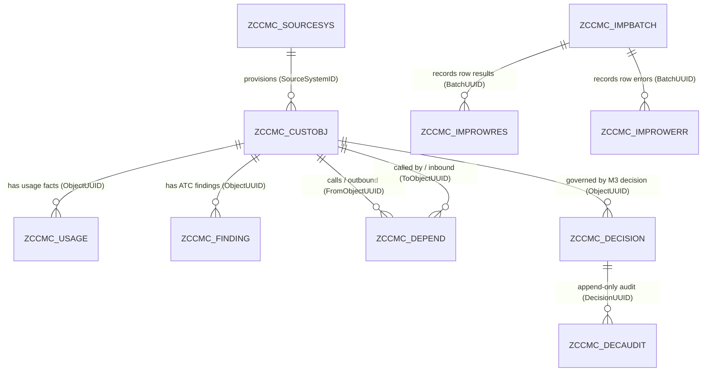

# Persistence ER Diagram — Member 1 (v0.3 — Aligned Physical & CDS Schema)

**Owner:** Member 1 — Persistence and Import  
**Version:** 0.3 (`M1-D03-T01` .. `M1-D11-T01`)  
**Status:** All 8 Member 1 database table definitions (`src/zccmc_data/*.tabl.xml`) and 8 CDS interface view entities (`src/zccmc_data/zccmc_i_*.ddls.asddls`) are authored in abapGit format and aligned with Member 3's RAP projections (`src/zccmc_rap/*`) and Member 4's UI metadata (`src/zccmc_ui/zccmc_customobject.edmx`). Live SAP ADT activation remains gated on non-`$TMP` package resolution (`docs/feasibility-note.md` F-02).

## 1. Entity Relationship Diagram (Mermaid)

## 2. Member 1 Physical Tables & CDS Interface Views (`src/zccmc_data/`)

| DDIC Table (`.tabl.xml`) | CDS View Entity (`.ddls.asddls`) | Primary Technical Key | Natural / Business Key & Uniqueness | Downstream Consumers |
|---|---|---|---|---|
| `ZCCMC_SOURCESYS` | `ZCCMC_I_SourceSystem` | `SOURCE_SYSTEM_ID` (`CHAR(40)`) | `SOURCE_SYSTEM_ID` | `ZCCMC_I_CustomObject`, `zccmc_cl_import_object_loader` |
| `ZCCMC_CUSTOBJ` | `ZCCMC_I_CustomObject` | `OBJECT_UUID` (`SYSUUID_X16`) | `SOURCE_SYSTEM_ID + OBJECT_TYPE + OBJECT_NAME` | M2 `zccmc_cl_rule_engine`, M3 `ZCCMC_C_CustomObject` & `ZCCMC_I_Decision`, M4 Fiori List/Object Page |
| `ZCCMC_USAGE` | `ZCCMC_I_UsageFact` | `USAGE_UUID` (`SYSUUID_X16`) | `OBJECT_UUID + PERIOD_START + PERIOD_END + EVIDENCE_SOURCE` | M2 `zccmc_cl_rule_engine` |
| `ZCCMC_FINDING` | `ZCCMC_I_Finding` | `FINDING_UUID` (`SYSUUID_X16`) | `OBJECT_UUID + FINDING_ID + CHECK_ID + SOURCE_REFERENCE` | M2 `zccmc_cl_rule_engine`, M4 `_Findings` facet |
| `ZCCMC_DEPEND` | `ZCCMC_I_Dependency` | `DEPENDENCY_UUID` (`SYSUUID_X16`) | `FROM_OBJECT_UUID + TO_OBJECT_UUID + DEPENDENCY_TYPE + EVIDENCE_SOURCE` | M2 `zccmc_cl_rule_engine` (inbound caller criticality) |
| `ZCCMC_IMPBATCH` | `ZCCMC_I_ImportBatch` | `BATCH_UUID` (`SYSUUID_X16`) | Generated per import attempt | M3 `ZCCMC_C_ImportBatch`, M4 Import Center |
| `ZCCMC_IMPROWERR` | `ZCCMC_I_ImportRowError` | `BATCH_UUID + SOURCE_RECORD` | Append-only per rejected CSV record | M3 `ZCCMC_C_ImportRowError`, M4 Import Center error table |
| `ZCCMC_IMPROWRES` | `ZCCMC_I_ImportRowResult` | `BATCH_UUID + SOURCE_RECORD` | Append-only per parsed CSV record (`INSERTED`, `UPDATED`, `UNCHANGED`, `REJECTED`) | Provenance audit & Day-10 reconciliation |

## 3. Exact Field Alignment Across Layers

- **`ZCCMC_I_CustomObject` -> `ZCCMC_C_CustomObject` (M3)**: Exposes `ObjectUUID`, `SourceSystemID`, `ObjectName`, `ObjectType`, `PackageName`, `Description`, `BusinessOwner`, `Criticality`, `FirstSeen`, `LastSeen`, `FindingsAsOf`, `LastBatchUUID`, `LastSourceRecord`, `RowSha256`, `CreatedAt`, `ChangedAt`.
- **`ZCCMC_I_ImportBatch` -> `ZCCMC_C_ImportBatch` (M3)**: Exposes `BatchUUID`, `FileKind`, `Status`, `FileSha256`, `Actor`, `CreatedAtUtc`, `ParsedCount`, `AcceptedCount`, `InsertedCount`, `UpdatedCount`, `UnchangedCount`, `RejectedCount`, `FileErrorCode`, `FileErrorMessage`.
- **`ZCCMC_I_ImportRowError` -> `ZCCMC_C_ImportRowError` (M3)**: Exposes `BatchUUID`, `SourceRecord`, `FileKind`, `BusinessKey`, `ErrorCode`, `FieldName`, `Message`, `CreatedAtUtc`.
